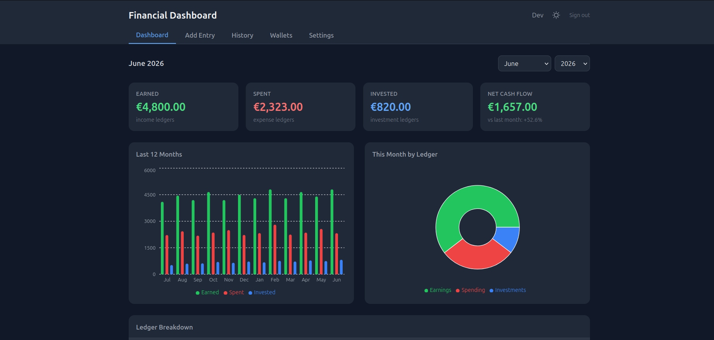
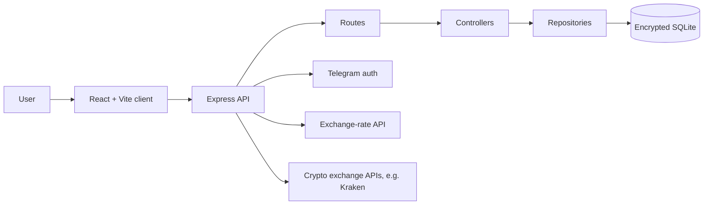

# Financial Dashboard

A self-hosted budgeting dashboard for observing financial state in real time and understanding where spending goes.

## Why I Built This

I built this project to observe my financial state in real time, understand where my spending goes, make more informed financial decisions, and plan my budget with less friction.

Instead of keeping expenses, balances, and investment-related notes spread across separate tools, this app gives me one place to track daily entries, compare monthly activity, and keep a clearer picture of my budget.

## What It Does

- Tracks income, spending, and investment entries through separate ledgers.
- Organizes transactions with ledger-specific categories and color-coded breakdowns.
- Shows monthly totals, charts, and category-level spending insights.
- Supports multiple currencies for entries and dashboard reporting.
- Tracks fiat wallets with baseline balances and entry-based balance updates.
- Supports exchange wallets, encrypted API credentials, and live crypto exchange balance checks.
- Uses Telegram login for authentication.
- Includes a responsive dark mode interface.

## Tech Stack

- **Frontend:** React, Vite, Tailwind CSS, Recharts
- **Backend:** Node.js, Express, SQLite, Umzug
- **Auth and security:** Telegram Login Widget, JWT, encrypted SQLite database, encrypted exchange credentials (KEK/DEK encryption)
- **Tooling:** Jest, GitHub Actions, custom scripts

## Architecture

The app is split into a Vite React client and an Express API server. The frontend talks to REST endpoints under `/api`; the server keeps business logic organized through route, controller, and repository layers; SQLite stores application data behind migrations and encryption.

In production, the Express server can also serve the built client from `client/dist`, keeping the deployable app as a single Node process.

## Security

Financial data is sensitive, so the project is designed around local ownership and explicit secrets:

- Telegram login is verified on the server before issuing a JWT session token.
- Runtime secrets live in environment variables.
- The SQLite database is encrypted with a dedicated database encryption key (using AES-GCM-256).
- Exchange API credentials use envelope encryption with a separate credential encryption key (KEK/DEK encryption).

## Setup

Installation, local development, environment variables, and production notes are documented in [SETUP.md](SETUP.md).

## Roadmap

- Expand automated test coverage (including dedicated security tests) across API routes and important frontend flows.
- Add more exchange integrations beyond Kraken.
- Improve reporting with exports and richer budgeting trends.

## License

MIT
